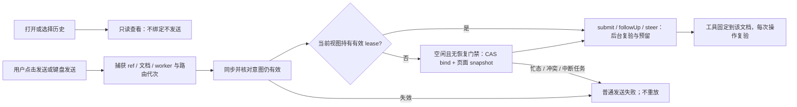

## 方案 v1.0：目标、基线与交付边界

删除标题栏下整个 `#continuation-panel`，包括当前对话/执行页面文字、接续按钮、常驻错误区；没有替代横幅、授权徽标、toast 或正常接续弹窗。用户在当前网页选择对话后直接发送，程序内部绑定该文档；只查看历史不执行。历史、返回执行页和异常任务管理进入已有对话菜单。

2026-11-13 研究基线为 `main` / `27072d61237553b7332cbbd4e23a9806949fba70` / v1.5.1；GitHub 当日 main 与最新 Release 一致。本次只交方案、隔离 PoC 与证据，不提交产品实现、实验补丁、生成包或发布配置；方案评审后由全栈开发实现。非目标：会话库迁移、全局自动选择最近对话、扩大页面权限、跨浏览器移植、重写任务调度器。

## 事实、候选与决定

现状不只是多余 UI：`src/install-template.html:1942` 在发送前拒绝未授权会话；`extension-content.js` 的 `continueHere()` 读取权威版本、执行 CAS 绑定并取得 lease；`continuations.js` 的 `submit()` 再校验 lease、文档、忙态并预留提交。`extension-engine.js` 完成页面 snapshot 后才返回绑定。复合 ref 使用 hostname 和本地 ID，不能拿 hostname 相同代替文档授权，协议/端口不同也不能共享 lease。

历史依据：[AIXI-29 PR #7](https://github.com/aitimos/pi-tab/pull/7) 与 [d434cb1](https://github.com/aitimos/pi-tab/commit/d434cb1)、[3f7f793](https://github.com/aitimos/pi-tab/commit/3f7f793) 分别建立显式接续和 worker 重建后不重发的约束；[2f32fa5](https://github.com/aitimos/pi-tab/commit/2f32fa5) 修复 SPA 实时 URL 登记。旧决定保护的是不随查看、导航或重连执行旧任务；当前需求改变独立接续按钮，不撤销这些执行边界。

| 候选 | 行为与失败 | 取舍 |
| --- | --- | --- |
| 只删/隐藏横幅 | 原发送门禁仍在，错误指向不存在的按钮 | 拒绝，不能完成请求 |
| 打开/选历史/激活标签时自动接续，工具取全局 active tab | 查看可能抢占；焦点变化可改变页面操作目标 | 拒绝，会削弱数据安全 |
| **用户发送时复用现有 bind → submit** | 新输入与具体文档绑定；版本冲突或失效拒绝且不自动重试 | **推荐**；无需新依赖、协议或存储 schema |
| 新建原子 bind-and-submit 协议/替换任务框架 | 可缩短绑定与提交间隙，但涉及 worker/engine/调度器新增契约 | 本次不采用；现有 lease 已使间隙竞争失败关闭，无需扩大架构 |

这是内部低风险选择，数据安全可保持等价：独立第二次点击明确取消，用户的“发送新消息”成为本次当前页面执行意图；不是声称仍有两次确认。仅查看不得写、文档 lease、运行中目标冻结、恢复不重放、冷任务清理须显式同意全部保留。若实现必须让后台自动抢占、重放或未经同意取消历史任务，停止该实现并按 issue 约定交 Mika，而非以本方案授权。

## 建议流程与交互

建议效果：正常路径只有“选历史 → 输入 → 发送”，不展示接续状态，也不要求理解 lease。现有消息区内的对话标题与站点头保留，不新增执行页说明。历史入口移入现有 `#chat-list`；打开后仍走原短期 grant 的独立 picker，来源站点/标题只在主动查看历史时呈现。picker 帮助改为“选择后仅查看历史。发送新消息时使用当前页面。”，中英同步。

“回到执行页”移入同一菜单，有有效目标时出现；仅聚焦既有标签/窗口，不重新创建已关闭页面、不导航、不绑定，也不发送任务。执行目标失效时菜单项隐藏，点击过程竞态走普通操作失败。`#stop-continue` 删除：需要停止时使用现有停止按钮；停止完成后的下一次新发送才允许绑定，不能缓存本次失败输入并在停止后自动发送。

中断任务不自动清除：冷来源保持暂停、来源级写门禁；仅在该来源存在 recovery 时，对话菜单按需提供原“停止来源站点的中断任务”操作。保留原确认对话框，列出来源、受影响会话和历史保留说明；取消无副作用，确认才按原版本调用 `recoverSource()` → `stopColdRuntime()`，等待前台/后台任务并复查排空。此操作是主动任务管理，不是每次接续提醒；正常打开/发送绝不弹确认。清理失败继续暂停，用户可再次主动清理；不把清理成功接成自动重发。

## 状态与失败契约（建议）

| 情形 | 内部规则 | 用户可观察行为 |
| --- | --- | --- |
| 新对话、同 hostname、子域、跨站、跨协议/端口 | 相同算法；来源 ref 不变；目标必须是发送事件所在文档，跨来源仍先获得 picker 选择权 | 直接发送，保留原上下文与模型设置；不出现提示区 |
| 历史打开、选择、窗口恢复、获得焦点、状态事件 | 只读订阅，不能获取新 lease，不能调用 prompt | 只展示消息；网络模型请求数不增加 |
| 当前视图同文档有效 lease 且 busy | 沿用现有 followUp/steer 语义，不重新 bind | 排队或插话；目标不变 |
| busy / queued / pending / inFlight / stopping 属于其他视图，或本视图 lease 已失效 | bind 拒绝；不抢占、不隐式 abort、不把输入排到远端目标 | 本次未发送，保留草稿；等待完成或使用现有停止按钮 |
| 同版本双窗口绑定、bind 与 submit 间被抢先绑定 | CAS 一胜；失效 lease 的 submit 拒绝；不获取新版本后自动重试 | 失败输入保留，用户可再发；提交一经预留，禁止切换 |
| reload、pushState/replaceState/hash、后退/前进、重定向、关闭、权限撤销 | 撤旧 lease/取消旧文档在途工具；不重新绑定旧任务；新的用户发送才可绑定新文档 | 历史可查看；新发送独立判定；已发生的网页副作用无法撤回 |
| worker/offscreen 重建，或发送中连接丢失 | 只读最多有界重试一次；旧 epoch/lease 不恢复；已接受或接受状态未知的写绝不重发 | 普通连接失败，刷新历史/队列供核对；下一次主动发送是新请求 |
| 冷来源有遗留任务 | 保留 paused 和 recovery.version；只在菜单主动确认清理后解禁 | 无常驻提醒；发送失败说明可从对话菜单停止中断任务；不丢历史 |
| 冷来源不存在/删除、未知版本、目录配额或扫描失败 | 沿用原拒读/整事务回滚/取消扫描，不创建或升级来源库 | 历史页显示错误并可刷新；目录故障不阻断已有合法 ref |
| 书签模式 | 不走扩展接续 wrapper；保留 origin 历史、独占锁 1500ms 和显式独立库 | 不增加菜单的扩展专用项，不改变书签行为 |

## 实施接口、数据与并发边界

在 `extension-content.js` 的隔离世界内部增加一次用户提交的准备方法，UI 的可信 click、桌面 Enter、followUp/steer 菜单统一进入；IME composition/Shift+Enter/移动端 Enter 保持现规则。`isTrusted` 用于拒绝脚本合成事件，不能代替后台 sender、grant、documentId 与 nonce 校验。普通 `prompt`/`runTool`/agent-to-agent/tab 工具调用不得因失效 lease 自行获取页面授权，特别是后台运行中的旧任务。

入口同步 `syncRoute()` 后立即捕获 `{ref, viewId, documentId, nonce, routeEpoch, url, origin, workerEpoch, selectionGeneration}`，放在闭包的一次提交意图中，不落盘、不暴露给网页。此处 documentId 从已验证登记获取；每个 await 前后核对 ref 与路由/worker/选择代次，覆盖 A→B→A、同 URL reload 和同一个 agent 对象的 selectChat 变化。不能在重连或路由同步后悄悄把旧意图改成新文档。若事件时登记未知，可完成读取，但拒绝本次提交，保留输入供新发送。

每个窗口在准备前就进入提交中状态，防双击与两次异步准备；不同聊天草稿与 pending 按 ref 管理。无有效 lease 时复用 `continueHere()` 的权威 view → CAS bind → snapshot；调用前后核对捕获意图，然后用该 lease 走原 `submit()`，客户端 requestId 一次生成。两步之间不宣称原子性：另一窗口先切换则旧 lease 拒绝，不能循环重绑定；submit 的串行准入和 pending 预留继续冻结目标。已有 lease 的队列消息也必须通过当前文档验证，不得凭 UI 的 authorized 缓存直接放行。

必须在最终提交前检查目标与意图，并复用所有后台复验。Chrome 的 [MessageSender](https://developer.chrome.com/docs/extensions/reference/api/runtime#type-MessageSender) 提供文档标识；[tabs.sendMessage](https://developer.chrome.com/docs/extensions/reference/api/tabs#method-sendMessage) 可按 documentId 定向。保留现有 `tabs.get` 实时 URL + 准确文档双向 nonce/origin/routeEpoch 验证；不能只信 sender.url（仓库已有 SPA 回归），也不能用 active tab 兜底。Chrome [worker 生命周期](https://developer.chrome.com/docs/extensions/develop/concepts/service-workers/lifecycle) 允许意外终止，因此不加保活轮询，不把 lease 持久化成自动恢复授权。

删除 `#continuation-error` 及其全部引用；操作失败用现有消息区或主动打开的历史/对话菜单错误位。`CONTINUE_HERE_REQUIRED` 可保留内部代码，用户文案改为“页面状态已变化，本次未发送，请重试。”；TARGET_INVALIDATED 改为页面已变化的普通失败，绝不出现“先点击在当前页继续/重新接续”。确定在 bind/准入前拒绝才标记 `notSubmitted` 并恢复原文本/附件；请求已接受或状态未知沿用历史核对规则，不伪装为可安全重发。目录故障只在主动历史页报告，不新增常驻通知。运行日志只记内部 requestId、结果码、阶段和代次，不记正文、密钥或完整 URL/query。

不改变 ConversationRef、来源 IndexedDB v1、派生历史目录 v1、storage.session 的查看选择和扩展权限。只删旧 UI/闲置文案，所有受控调用方一起更新；不增加兼容分支或第三方状态框架。

## 可排期修改清单与验收门槛

| 顺序 | 文件/职责 | 实施及必须保留的断言 |
| --- | --- | --- |
| 1，准入 | `src/extension-content.js`、`tests/extension-content.test.mjs` | 一次提交意图、准备锁、document/worker/选择代次核对；可信发送取得 lease，读操作不取得；导航/重连/双窗口竞争不自动重试 |
| 2，UI | `src/install-template.html`、`src/history-picker.js`、`src/continuation-errors.js`、`src/locales/en.json` | 真正删除横幅 DOM/CSS/旧按钮/旧门禁/失效绑定；菜单迁移历史、返回、按需恢复；正常发送无需独立确认，失败保留正确草稿 |
| 3，安全回归 | `tests/continuations.test.mjs`、`tests/extension-worker.test.mjs`、`tests/extension-engine.test.mjs`、`tests/recovery.test.mjs`、`tests/i18n.test.mjs` | 保留 lease/CAS/epoch/预留、来源授权、精确文档工具、停止排空与未知写结果不重发；新增准备中导航、A→B→A、准备中切会话/换 worker、同 lease 队列与来源恢复取消/失败 |
| 4，真实浏览器 | `scripts/test-continuations.mjs`、`scripts/test-worker-recovery.mjs`、`scripts/test-message-queue.mjs` | 删除点击 continue/授权 DOM 作为前置条件；改成真实新发送。刷新/SPA 后“发送应被门禁拒绝”改为“旧任务不自动恢复；新可信发送可绑定”。冷恢复与 busy 抢占仍拒绝 |
| 5，全部调用方 | `scripts/test-extension-ui.mjs`、`test-management.mjs`、`test-model-settings-ui.mjs`、`test-model-provider-ui.mjs`、`test-oauth.mjs`、`extension-test-rpc.mjs` | 更新旧按钮操作和测试助手授权逻辑；测试桥不得替真实发送申请 lease，不以删除断言换通过；toolbar 单窗口、多聊天、设置、OAuth 全保留 |
| 6，交付 | `README.md`/`README.en.md`、`docs/usage.md`/`usage.en.md`、受跟踪构建产物 | 更新接续/冷恢复说明；基于正式源码构建同步产物；不手动升版本或修改 workflows |

最低验收：中英、窄屏、键盘路径无横幅/接续提示且菜单可达；历史/返回不发请求；三类站点真实模型上下文及 DOM 写目标正确；旧文档工具/旧 lease/旧 epoch 必拒绝；同 URL reload、SPA 全部路由方法、双 UI、权限拒绝、关闭、运行中/队列、冷恢复取消与失败、已接受/未知写结果不重发均有断言。先 `npm ci && npm run build && npm test && node scripts/release.mjs verify`，再跑 `test:tabs`、`test:queue`、`test:extension`（中英）、`test:bookmarklet`、`test:i18n`、`test:management`、`test:oauth`、`test:mcp` 和既有完整 CI 浏览器矩阵。正式新准入代码目标行覆盖率 ≥80%，不能拿本次 PoC 的通过数替代覆盖率与独立测试。

## 本轮实验与证据

独立目录从固定基线 `git archive` 得到 before/after，两者运行真实 `build.mjs`；after 仅修改实验副本的模板和 picker，复用未经修改的生产 lease 协调器及确定性本地 SSE 模型服务，使用空白浏览器 profile。源码补丁和复现脚本随 AIXI-45 交付附件保存，不进入生产；截图不是手工编辑 DOM 或设计稿。

macOS arm64；构建/单测/最终浏览器运行器 Node 26.3.0，Playwright 1.57.0，实际浏览器 Chromium 149.0.7827.55。锁文件 `npm ci` 通过；基线构建、release verify 和单测 **147/147** 通过。首次单测与构建并发导致生成物比较失败，构建结束后按顺序重跑全部单测通过；产物只在实验中保留，产品 checkout 已还原。Chromium 143 下载后解压停滞，已取消该安装进程，使用已有 149；不声称验证 143/Linux/真实 linux.do。

`admission.test.mjs` **8/8**：跨站新发送、只读不授权、非可信意图拒绝、bind/submit 间导航、竞争绑定使旧 lease 拒绝、提交中禁止重绑、旧 epoch 拒绝、未知结果不重放。它是复用原 `Continuations` 的隔离组合实验，不是完整生产 wrapper 的证明。

`browser.mjs` 最终通过：来源 `localhost`；目标 `localhost` 同站、`sub.localhost` 子域、`127.0.0.1` 跨站，各验证选择不发请求、原上下文保留、DOM 只写目标页、reload 不重放、新发送可在 reload/SPA 后绑定、菜单返回聚焦目标页；另验证脚本 click 被拒绝、键盘发送、旧 UI 节点已删除、中文前后及英文窄屏截图。英文截图首次等待不可见 Send 按钮超时，修正夹具为等待 host 语言后最终全通过，未改产品来绕过测试。

附件包括 `before-panel-zh.png`、`after-panel-zh.png`、`after-conversation-menu.png`、`after-panel-en-narrow.png`、原始测试/构建日志、`browser-results.json`、精简补丁与复现说明。PoC 仅证实外观与基本组合可行；没有实现完整意图代次/准备防重入，未验证真实冷遗留任务、worker stop、权限撤销、所有 SPA 方法、受保护页和完整矩阵，也未测覆盖率/性能。正式验收必须补齐上表，不能将 PoC 直接合并。

## 风险、维护、回滚与退出

最高风险是把“没有 lease”当成所有后台操作都可自动重绑；防线是仅新用户发送进入准备、意图代次检查与原后台校验。第二是隐藏 banner 时顺带丢掉 binding_state 的 busy/history 同步，必须将状态同步与渲染分开。第三是准备阶段双击、切会话后错误恢复草稿以及冷来源全站取消；均有明确归属与主动确认要求。独立第二次确认带来的额外人为阻挡已按用户要求取消，技术上保持不误发；模型因新用户输入继续使用旧上下文的内容风险仍存在，与原人工接续后相同。

不新增 npm 包、权限、基础设施、持久数据契约或维护服务。当前仓库 Apache-2.0，Pi 1.4.0 为 MIT，Playwright 1.57.0 为 Apache-2.0；沿用 lockfile 与许可证通知。GitHub 原仓库最新发布 2026-11-11，活动/维护依据上述固定提交与 PR，不以 star、X 或营销证明安全；没有引入需单独评估活跃度的新开源候选。文档/源码优于社区建议，本次无需要 X 交叉验证的选型争议。

成本预期：正常已授权发送不新增绑定；首次新文档发送多一次现有 view/bind/snapshot；不增加后台轮询。未做延迟/内存基准，不承诺性能改善。主要维护成本是迁移依赖旧按钮的浏览器夹具；依赖和退出成本均保持现状。

本方案审查完成前不发布。正式实现走现有 PR/独立测试/复审和 Release/Pages；无配置变更。发布者需验证安装包/Pages 的同一版本与 SHA、实际安装无提示区和关键写目标、旧历史可读及版本健康，而不能只看 CI。失败先停任务，保持同扩展 ID 加载 v1.5.1 或上一已验证包并刷新业务页；不卸载、不清历史，不恢复旧 lease，已发生的网页操作不可回滚。书签用户更换旧安装页生成的书签；未改变 schema，可直接退出 wrapper、还原旧接续 UI 与门禁，无数据迁移。

下一步：方案评审确认发送意图契约与异常任务管理位置；通过后由全栈开发依顺序实施，并用正式构建替换实验截图。官方资料访问日期均为 2026-11-13；runtime 正文访问两次超时，documentId/origin 结论由 Chrome 官方搜索摘要、tabs 官方正文及固定源码交叉核对，未将受限内容描述为完整阅读。

## 正式实施（2026-11-13）

基于以上 v1.0 与评审提交 `018a56d8f7d79cdeac6c6be50d287ad09b76675a` 实施。顶部接续区、旧按钮、错误位和“先接续再发送”文案已删除。对话菜单保留历史、有效执行页返回与按需中断任务清理；清理确认显示来源、会话和历史保留说明，使用确认时的 recovery.version。

`prepareSubmission(event)` 在可信新发送时同步捕获文档登记、路由、worker 及会话选择代次，逐次等待后复验；返回一次性提交闭包，再检查 lease 和意图。每个窗口在准备前锁定，完成准备后释放以保留队列/插话能力；每次准备使用独立标识，旧任务完成不会释放新准备的锁。仅准备或后台准入明确拒绝才恢复对应 ref 的文本/附件草稿，已接受与未知结果不恢复、不重发。普通 prompt、工具、查看与重连不触发自动绑定。返回执行页同时聚焦原标签与窗口。

受控浏览器夹具改为真实鼠标/键盘新发送，RPC 测试桥已删除自动授权。迁移保留了原 lease/CAS、导航失效、忙态、冷恢复及不重放断言，新增准备中导航/选会话/A→B→A/换 worker、双击、最终闭包撤权、准入与已接受失败区分。真实浏览器覆盖跨站上下文、DOM 目标、全部 SPA 路由、同 URL reload、跨窗口聚焦及冷清理取消/失败重试。

本地环境为 macOS arm64、Node 26.3.0、Playwright 1.57.0、Chromium 149.0.7827.55。构建、版本校验及 161 项单测通过。扩展中英、书签、语言、队列、模型设置、提供商、MCP 与 Linux 工具已实际运行；完整命令结果、最终提交及截图随 issue 交付证据记录。新准入方法及嵌套闭包的 V8 非空行覆盖为 35/35，非空行口径不代表全仓覆盖率；V8 范围记录保留在证据中。

环境限制：management、oauth 脚本主动要求 Linux，未绕过。Stop/Markdown 的停止与刷新断言通过，macOS 上 Shift 横向滚动断言超时；`27072d6` 隔离基线在同环境、同断言复现，故未修改无关滚动行为。Linux CI 由既有工作流执行。本阶段尚未合并、发布或部署；正式独立测试使用 PR 的最终 HEAD，发布仍按既有 Release → Pages 链，不手动升版本。

首次正式提交 `ac6bfac` 的 Linux CI 又暴露三处迁移夹具问题：Stop 的发送助手误限定源 tab、Linux 工具助手读取了上一轮工具结果、worker 重启后的 OOPIF 关闭点击未送达。后续测试修正保留业务断言：按目标标签真实发送、等待输入被消费并按新增历史条目核对新工具结果、使用聚焦后的原生键盘关闭选择器。产品源码与安装包不变；本地重跑与新 CI 状态由最终交接记录给出，不能将首次 CI 描述为通过。

### 独立测试返工

独立测试以 `ac6bfac` 复现双标签发送助手错误；该项已由 `868c413` 修正，后者 Linux CI 的完整 Stop 套件通过。后者仍有两项失败：Linux 工具发送后输入未消费，worker 套件末尾捕获未分类连接异常。

Linux x86_64 / Chromium 143 隔离复现抓到真实命中问题：agent_spawn 的子窗口覆盖源窗口，旧坐标点击使源窗口收不到任何 pointer/click 事件。CLI 发送助手改为指定窗口原生按钮聚焦后的可信 Enter，保留重叠窗口与多 Agent 行为，避免激活错误窗口。工具结果仍按本轮新增历史条目验证，不获取额外 lease、不重发。worker 测试改用不含 picker 初始化请求的静态扩展控制页，保留所有页面异常的严格空集合断言，并记录异常堆栈和所属页面；不筛掉连接错误。产品源码与构建产物均不变。最终 HEAD、Linux 143 复验与 CI 结果以本轮交接证据为准。

Linux 143 连续复验还暴露了菜单异步关闭与下一次切换竞争。夹具现按实际状态打开菜单，并等待 iframe 与菜单操作同时结束。历史选择/关闭和首轮重启使旧 grant 失效仍通过真实 UI 验证；后续队列、工具在途与 worker/offscreen 重建使用已发布 content API 的纯读取唤醒，新增读取不取得执行授权的断言。静态控制页不加载 picker 业务脚本；页面异常仍严格要求为空，保存堆栈而不白名单过滤。修正后完整 Stop、Linux 工具与 161 单测通过，最终恢复循环及 CI 详见返工交接。

主线集成：返工期间 main 已发布 `0d71487` / v1.5.2。最终交接合入该主线，保留其后台标题取消和鉴权失败后配置恢复修复。源码无逻辑冲突；生成物从合并后的源码重建，模型设置夹具仅去掉主线新增代码附近仍引用旧接续按钮的前置条件，保留新增鉴权/配置断言。候选版本因此沿用主线 1.5.2，并非手动升版；最终安装包 SHA 与复验基线重新记录，不能继续引用 1.5.1 候选包作为最终包。同步主线也解除 PR 冲突，使完整 PR CI 能在合并后的基线上运行。
